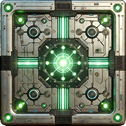
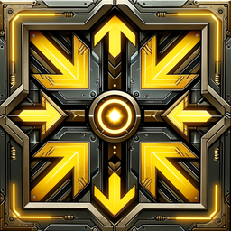
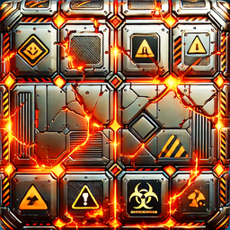
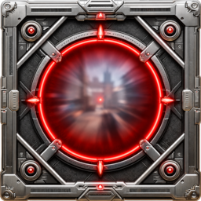
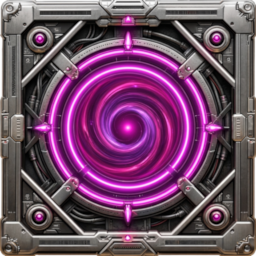
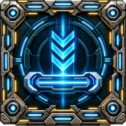

# Breakout

A modern take on the classic brick-breaker. Clear all destroyable bricks while keeping the blue “hero” ball in play. Power-ups, lasers, inversion, and multi-ball keep things lively. It runs as a desktop game (Python and Pygame) and as a [browser version](#web-version) (try it [here](https://breakout.7thsoftware.co.uk/)) that plays the same game on a canvas, with touch support.


## Features

- Six handcrafted levels with per-level brick layouts (eleven in the browser version, where rows of bricks can sway from side to side)
- Multiple brick types with unique effects and hit points
- Bonus balls, extra bats, control inversion, laser mode, and blackout mode
- Stereo-panned sound effects and chiptune background music (toggle with **M**)
- Multi-monitor aware with dynamic resizing
- A browser version in the `web` folder, with mouse and touch controls
- Smooth intro scene with perspective-warped card and animated balls

## Requirements

- **Python**: 3.10 or newer  
- **OS**: Windows, macOS, or Linux with a working SDL2 video driver

### Python packages

Installed via `pip`:

- `pygame` – rendering, input, audio
- `opencv-python` – intro image warping
- `numpy` – array ops and masks

#### Dependencies

```txt
pygame>=2.5
opencv-python>=4.9
numpy>=1.24
```

Note: this game is also compatible with Pygame Community Edition. If you would prefer to use that, simply replace `pygame` with `pygame-ce` in the installation process.

## Installation and Setup

```bash
# 1) Create a virtual environment (recommended)
python -m venv .venv

# 2) Activate the virtual environment
# Windows
.venv\Scripts\activate
# macOS/Linux
source .venv/bin/activate

# 3) Ensure the 'pip' tool is up to date
python -m pip install -U pip

# 4) Install dependencies
pip install pygame opencv-python numpy
```

## Running the game

```bash
# 1) Activate the virtual environment (if you haven't already done so)
# Windows
.venv\Scripts\activate
# macOS/Linux
source .venv/bin/activate

# 2) Start the game
python breakout.py
```

You can also pass the `--ratio` (or `-r`) parameter to scale the graphics down by a specified amount, e.g.

```bash
python breakout.py -r 4
```

will down-scale all of the graphics by a factor of four (horizontally and vertically). Higher values give more retro vibes! If your machine struggles to play Breakout smoothly at full resolution, increasing the `-r` parameter should reduce CPU load.

## Mouse sensitivity

Pointer movement is scaled so that moving the bat from one side of the playfield to the other takes the same hand movement on any monitor, whatever its resolution. If you'd like it quicker or slower, pass `--sensitivity` (or `-s`): `-s 1.5` needs a third less movement, `-s 0.75` a third more.

## Monitor selection

If you have multiple monitors, you can pass the `--monitor` (or `-m`) parameter to specify the desired monitor number (with 0 being the primary display).

```bash
python breakout.py -m 2
```

If this parameter isn't passed and there are multiple monitors detected, you will see a monitor selection icon in the top-left of the intro screen. Clicking this will move the game to each monitor in turn.

## How to play

- **Goal**: Destroy all destroyable bricks in a level without losing all of your lives.
- **Lives**: You lose one life each time the blue hero ball falls off the bottom. Some bricks grant extra lives.
- **Levels**: Clear a level to advance.

### Controls

- **Mouse**: Move the bat horizontally. Where the ball lands on the bat sets the angle it leaves at: the centre sends it straight up, the ends send it off sideways
- **Left click**: Launch the ball when it is sitting on the bat (it launches by itself after a few seconds). Hold the bat still to send it straight up, or flick the bat sideways as you click to send it off at an angle. Otherwise, a click speeds all the balls up a little
- **Space**: Pause or resume
- **M**: Music on or off (also works on the intro screen)
- **Q / Esc**: Quit

### Music

The intro and each level have their own chiptune track, played at a volume that leaves room for the sound effects. Levels 4 to 6 bring the first three tunes back faster (and higher), old-school style. In the browser version a level that goes back over an earlier one carries on with its tune; levels 6 to 11 have three more tunes of their own, by the same composer, and the certificate at the end of a game plays an ending. Start with it off using `--no-music`, or set the level with `--music-volume 0.25` (0 to 1). The tracks live in `web/music`; see `web/music/CREDITS.txt`.

- **Intro screen**: Move the mouse over the menu to select a difficulty, then click or press any key

### Brick types

| Brick                                            | Type                 | Description                                                                                                                                                                                                                                                               |
| ------------------------------------------------ | -------------------- | ------------------------------------------------------------------------------------------------------------------------------------------------------------------------------------------------------------------------------------------------------------------------- |
|                   | **Blue**             | Standard; no effect                                                                                                                                                                                                                                                       |
|                    | **Red**              | Spawns a temporary red bonus ball                                                                                                                                                                                                                                         |
|                  | **Green**            | Adds a temporary extra bat                                                                                                                                                                                                                                                |
|             | **White star**       | Grants an extra life                                                                                                                                                                                                                                                      |
|             | **Black hole**       | Temporarily darkens the screen                                                                                                                                                                                                                                            |
|          | **Yellow arrows**    | Temporarily reverse controls                                                                                                                                                                                                                                              |
|           | **Cracked fire**     | Destroys neighbouring bricks (cascade)                                                                                                                                                                                                                                    |
|                  | **Metal**            | Indestructible                                                                                                                                                                                                                                                            |
|       | **Warning triangle** | Enables laser mode for a duration                                                                                                                                                                                                                                         |
|               | **Red lens**         | Blurs your view and reddens its edges for 15 seconds, fading over the last five, and every one makes it worse while they overlap (web version only; Hard gets one on level 7, two on 8 and 9, three on 10 and 11, Medium at most one a level, Easy none)                  |
|            | **Safety net**       | A glowing bar floats up from below to just under the bat and stays for a few seconds, then pulses for four more as a warning before it goes; any ball that reaches it bounces back up, a little slower. Another one while it's up keeps it longer (web version only)      |
|           | **Regenerator**      | Brings back a tenth of the level's bricks, one at a time over a few seconds, each popping into the place of a brick you'd already broken (never one the ball is in). They come back as ordinary bricks. One on level 5, two on each level after (web version only)         |
|      | **Sticky bat**       | For ten seconds (another adds ten more), a ball landing on a bat sticks to it where it landed; a click or tap launches it, aimed by where it sits. The bats glow, pulsing faster near the end, when the rest go (web only)                                                 |

Different brick types require different numbers of hits to destroy. If no brick is destroyed for a while, an extra bonus ball is introduced.

## Web version

The `web` folder holds a browser version of the game: a port to plain JavaScript on the HTML canvas, with no build step. It plays the same levels with the same physics, speed model and power-ups, fills the browser tab, and works with touch as well as a mouse. It also has five extra levels, eleven in all: after each of levels 2 to 6 comes a version of it, at the same pace and to the same music, with one or two rows of metal bricks swaying from side to side (with some breakable bricks among them, and all of them breakable on Easy, which has no metal), and more extra lives. The later ones lose a row or two of the original to make room, so they reach no lower down the screen. The kinds of brick arrive gradually: level 1 has only the plain ones and an extra life, and each level after brings at most two kinds you haven't met (fire and lasers on level 2, metal on 3, safety nets and black holes on 4, the regenerator on 5, inversion on 6 and the red lens on 7, where the difficulty has them). The level's banner introduces each new one with its picture, its name and a few words, and stays up a little longer to give you time to read them (a click or tap skips it). The folder is self-contained — the page, the scripts, and the sprites, sounds and music (the desktop game loads the sounds and music from there too, and its sprites from `images`) — so it can be copied as it is to any static web server.

### Running it locally

Browsers won't let a page fetch audio from a `file://` URL, so it has to be served over HTTP. Any static server will do; Python has one built in:

```bash
python -m http.server 8000 --directory web
```

then open http://localhost:8000/ in a browser.

### Publishing

Copy the `web` folder to a static web server (SFTP, S3, GitHub Pages, whatever you have). Nothing needs building, and there are no other dependencies. The folder also carries the favicon, a home-screen icon for phones, and a web app manifest, so a phone that adds the page to its home screen gets a proper icon and launches it fullscreen. That installed-app launch needs the page to be served over HTTPS (a plain `http://` test server gives a bookmark that opens in the browser instead), and Samsung Internet also wants the small service worker in `sw.js`. That worker stores nothing itself, but it does make the browser check each script, image and sound with the server on every launch, so a freshly uploaded version is picked up next time the game is opened, installed or not (the launch after an upload may still be the old one, since the worker itself updates on that launch). In Samsung Internet, once the page has loaded over HTTPS a small download-style icon appears at the right-hand end of the address bar; tapping it offers "Add to apps", which installs it (the menu's "Add page to Home screen" only makes a bookmark). Android then shows a warning about the app being unsafe, because the wrapper isn't from an app store; that's Samsung's wrapper, not the page, and can be waded past. The page downloads about 17 MB, most of it the music and the sprites. The sprites in `web/sprites` are WebP copies, a fifth of the size, of the PNG masters in `images` (which the desktop game loads). After changing or adding a sprite there, run `python tools/make_webp.py` (it needs Pillow) to make its WebP copy; `--quality`, `--lossless` and `--all` are there if wanted.

### Controls

| Input                              | Action                                                                                                                                                                                                                                                                                            |
| ---------------------------------- | ------------------------------------------------------------------------------------------------------------------------------------------------------------------------------------------------------------------------------------------------------------------------------------------------- |
| **Click, tap or any key**          | Dismiss the title card (browsers only allow sound after you've interacted with the page)                                                                                                                                                                                                          |
| **Mouse**                          | Moves the ball on the intro (it lights up the difficulty it's over) and the bat in play. Swipe the bat under a ball as it bounces and it spins away, its path curving the other way from the swipe until the spin dies down, and its bounces kicked sideways by the spin (web version only)       |
| **Touch**                          | The ball on the intro, and the bat in play, sit under your finger: put it down anywhere across the screen and the bat goes there. On a phone the intro's ball rolls with the tilt of the phone instead, like a ball on a tray. It's just for fun there: tap Easy, Medium or Hard to start         |
| **Tilt**                           | On a phone, turn on Steer the bat by tilting in the options and the bat is steered by rolling the phone like a steering wheel, at any difficulty: about 45° either way (37° in landscape) reaches the edge. How the phone is held when a level starts, or a pause ends, counts as level           |
| **Click / tap**                    | On the intro, a click or tap on a difficulty starts the game (anywhere else does nothing); launches the ball when it's sitting on the bat; otherwise speeds all the balls up a little                                                                                                             |
| **Up / Down, then Enter or Space** | Choose a difficulty on the intro and start the game                                                                                                                                                                                                                                               |
| **Two-finger tap**                 | Pauses and opens the Options page: music, fullscreen, help, and quit to the menu. On the intro it offers music, fullscreen, help and credits, as the Options link does on a desktop (on a phone, that's where Help and Credits live)                                                              |
| **Space**                          | Pause or resume                                                                                                                                                                                                                                                                                   |
| **M**                              | Music on or off (remembered for your next visit)                                                                                                                                                                                                                                                  |
| **F**                              | Fullscreen on or off                                                                                                                                                                                                                                                                              |
| **L**                              | Capture or release the mouse for the game in hand. It's captured while you play, so it can't leave the page, and given back on the banners, the pause, the certificate and the intro (**Esc** releases it too, and pauses). To leave it free in every game, turn it off in the options (**O**)    |
| **Q**                              | Back to the intro                                                                                                                                                                                                                                                                                 |
| **O**                              | On the intro, the Options page, as does the Options link at the foot of the intro: music, fullscreen, capturing the mouse in play (remembered for next time; not on a phone), help and credits                                                                                                    |
| **H / C**                          | On the intro, the Help and Credits pages, which are also on the Options page                                                                                                                                                                                                                      |

Moving the bat from one side of the playfield to the other takes the same hand movement on any screen, as in the desktop version, except that the mouse is never slowed down: on a screen or window narrower than 1920 pixels the cursor's full width maps to the full playfield, so the bat can always reach the sides. A finger needs no such scaling: the bat is simply wherever the finger is.

### Winning, and losing

Clear the last level and the win screen is a certificate, headed by the Breakout logo: the difficulty, the play mode (Desktop, Mobile (touch), or Mobile (tilt) when the phone's roll steered the bat), the lives you had left, the time spent in play (the game clock, which stands still during the level banners and pauses) in minutes and seconds to the hundredth of a second, and the date and time the first level began. Lose your last life and you get the same certificate headed Game Over!, with how long you lasted and the level you reached in place of the lives line. The box in the top-right corner takes a selfie with the front camera (the browser asks permission first; the preview is mirrored, and so is the photo, so you get what you saw) and puts it on the certificate. The photo never leaves the device: nothing is uploaded, as a footnote on the certificate says, and the Help page has a short privacy note (no cookies or trackers, nothing collected; only the settings are kept, in the browser). The box in the top-left saves the certificate as a PNG, named for the difficulty and the start time, which on a phone lands in the gallery's Downloads album; **S** does the same on a keyboard. Tap or click anywhere else, or press any other key, to go back to the intro.

### On a phone or tablet

The page notices when it's on a device whose main pointer is a finger and adjusts itself: the prompts say "tap", the mouse is never captured, the bats sit a little higher and are drawn half as wide again in landscape so they show either side of the fingertip driving them, and the Help page describes the gestures instead of the keys. On the intro the ball is rolled by tilting the phone: lay it flat and it sits still, and every deviation from flat rolls the ball (held at a viewing angle it just rests against the bottom edge). A tap on Easy, Medium or Hard starts that game; the ball is just for fun, and a tap anywhere else does nothing. At any difficulty the bat can be steered by rolling the phone like a steering wheel rather than by the finger: turn on Steer the bat by tilting on the Options page (a two-finger tap on the intro, where it's offered so that a game is played one way throughout). It's remembered for next time, and the intro and the level banner remind you while it's on. A two-finger tap is the way to get at everything the keyboard would otherwise do, and on a phone the level banner says so. It's best played in landscape, and fullscreen follows the orientation rather than being locked: in landscape the next tap goes fullscreen, and turning the phone to portrait drops out of fullscreen and gives the address bar back, so you're never trapped in the game. If you back out of fullscreen while still in landscape, taps leave it alone until you've turned the phone again. The Options page's Fullscreen button toggles it by hand. Adding `?mobile=1` or `?mobile=0` to the address forces the mobile or desktop behaviour, which is handy for trying the touch layout on a desktop with a touch screen.

### Options

Options go on the URL, for example `http://localhost:8000/?music=0&sensitivity=1.5`:

| Option                  | Effect                                                                                                                                                                                                                                                                                                                                                                                |
| ----------------------- | ------------------------------------------------------------------------------------------------------------------------------------------------------------------------------------------------------------------------------------------------------------------------------------------------------------------------------------------------------------------------------------- |
| `music=0`               | Start with the music off, whatever was remembered from last time                                                                                                                                                                                                                                                                                                                      |
| `volume=0.25`           | Music volume, 0 to 1 (default 0.4)                                                                                                                                                                                                                                                                                                                                                    |
| `sensitivity=1.5`       | Mouse sensitivity multiplier (default 1)                                                                                                                                                                                                                                                                                                                                              |
| `mobile=1` / `mobile=0` | Force the phone-and-tablet behaviour on or off, instead of detecting it                                                                                                                                                                                                                                                                                                               |
| `debug=1`               | Developer cheats: 99 lives (or `lives=6`, say, for a given number), **D** destroys every brick, a click destroys the brick under the pointer, a digit key jumps straight to that level, **P** saves a screenshot of the playfield as a PNG, and **X** on the intro sets up a busy level 5 on Hard (bricks gone and returning, every bat out, lasers, a crowd of balls) to take one of |

### Things worth knowing

- The page opens on a title card and waits for a click, tap or key. That first interaction is what lets the browser start playing sound. The card also shows the one rule nobody can guess: let the blue ball fall and you lose a life, but the red bonus balls are free.
- A playfield wider than 16:9 or narrower than 4:3 is letterboxed, as on the desktop, so the brick layout stays playable. Resizing the window (or rotating a tablet) rescales the game in place.
- The page is designed to be cheap when it's not being played: the title card and a settled intro screen render at a low frame rate, a paused game and the certificate at one frame a second (a click, tap or key is still answered at once), and the browser stops the game entirely while the tab is hidden.
- Wobbling the bat from side to side fast enough would catch everything, so a bat that turns round too often (more than eight times in a second, not counting tiny jitters) is worn out for a couple of seconds: it's drawn faded and can only crawl. A single desperate swipe across the playfield never triggers it.
- On a desktop the mouse is captured while a level is being played, and only then: the level banners, a pause, the certificate and the intro all give it back, and so does Esc. Each level waits for a click before it starts (Click to start..., and the click serves), since a browser only lets a page capture the mouse from a click or key press. **L** turns it off for the game in hand, and the Options page for every game. Until it has first been taken in a game, the prompt says how to get it back. Capture is never offered on a phone or tablet.
- To try it on a phone, serve the folder on your network rather than just this machine (`python -m http.server 8000 --bind 0.0.0.0 --directory web`) and open `http://<this machine's address>:8000/` on the phone.

## Troubleshooting

- **No video device / SDL errors (Linux)**: Ensure you are in a graphical session and SDL2 can open a display. On headless systems set up Xvfb or Wayland appropriately.
- **OpenCV import errors**: Use `opencv-python` wheels rather than `opencv`. On some Linux distros you may need system OpenGL packages.
- **Fonts missing**: The code uses the default Pygame font; if you change it (e.g. to a system font), ensure it is installed.
- **Black bars**: on a monitor wider than 16:9 (or narrower than 4:3) the playfield is letterboxed so the brick layout stays playable. This is deliberate.
- **Windows display scaling**: the game declares itself DPI-aware so that a high-resolution monitor with Windows scaling (for example a 4K panel at 200%) is used at its native resolution rather than the scaled-down size. If you need the old behaviour, set the environment variable `SDL_WINDOWS_DPI_AWARENESS=unaware` before running.

## Debugging

Run with `--debug` to enable a few developer cheats during play: **D** destroys every brick (skipping the level), **right-click** shows the mouse pointer, and **left-click** destroys the brick under it. They are switched off in normal play.

## Credits

- Pygame community ( https://www.pygame.org/contribute.html ) for an excellent Python module
- The very useful sfxr ( https://sfxr.me/ ) for sound effect generation
- Background music: "Chiptune Adventures" and the "Retro Game Music Pack" by Juhani Junkala ( https://juhanijunkala.com/ ), released under CC0 via OpenGameArt ( https://opengameart.org/content/4-chiptunes-adventure and https://opengameart.org/content/5-chiptunes-action )
- A nod to Arkanoid, Fireball 2 (Archimedes), and other classics
- Final level background: Rosette Nebula ( Dylan O'Donnell, https://deography.com/will-you-accept-this-rose-ngc2237/ )
- Thanks to ChatGPT for art assistance
- Web conversion by Anthropic's Claude ( https://www.anthropic.com/claude )

---

_Dedicated to Helena and Karen._
