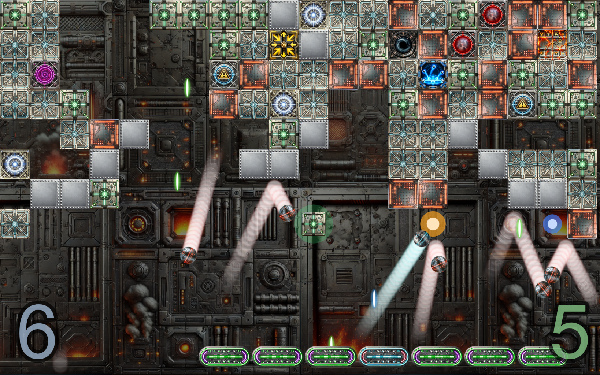
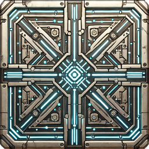
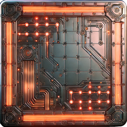
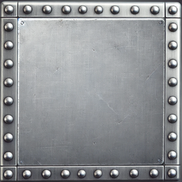
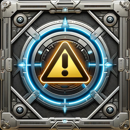

# Breakout

A modern take on the classic brick-breaker. Clear all destroyable bricks while keeping the blue “hero” ball in play. Power-ups, lasers, inversion, and multi-ball keep things lively. It runs as a desktop game (Python and Pygame) and as a [browser version](#web-version) that plays the same game on a canvas, with touch support.



## Features

- Six handcrafted levels with per-level brick layouts
- Multiple brick types with unique effects and hit points
- Bonus balls, extra bats, control inversion, laser mode, and blackout mode
- Stereo-panned sound effects and chiptune background music (toggle with **M**)
- Multi-monitor aware with dynamic resizing
- A browser version in the `web` folder, with mouse and touch controls
- Smooth intro scene with perspective-warped card and animated balls

## Requirements

- **Python**: 3.10 or newer  
- **OS**: Windows, macOS, or Linux with a working SDL2 video driver

### Python packages

Installed via `pip`:

- `pygame` – rendering, input, audio
- `opencv-python` – intro image warping
- `numpy` – array ops and masks

#### Dependencies

```txt
pygame>=2.5
opencv-python>=4.9
numpy>=1.24
```

Note: this game is also compatible with Pygame Community Edition. If you would prefer to use that, simply replace `pygame` with `pygame-ce` in the installation process.

## Installation and Setup

```bash
# 1) Create a virtual environment (recommended)
python -m venv .venv

# 2) Activate the virtual environment
# Windows
.venv\Scripts\activate
# macOS/Linux
source .venv/bin/activate

# 3) Ensure the 'pip' tool is up to date
python -m pip install -U pip

# 4) Install dependencies
pip install pygame opencv-python numpy
```

## Running the game

```bash
# 1) Activate the virtual environment (if you haven't already done so)
# Windows
.venv\Scripts\activate
# macOS/Linux
source .venv/bin/activate

# 2) Start the game
python breakout.py
```
You can also pass the `--ratio` (or `-r`) parameter to scale the graphics down by a specified amount, e.g.

```bash
python breakout.py -r 4
```
will down-scale all of the graphics by a factor of four (horizontally and vertically). Higher values give more retro vibes! If your machine struggles to play Breakout smoothly at full resolution, increasing the `-r` parameter should reduce CPU load.

## Mouse sensitivity

Pointer movement is scaled so that moving the bat from one side of the playfield to the other takes the same hand movement on any monitor, whatever its resolution. If you'd like it quicker or slower, pass `--sensitivity` (or `-s`): `-s 1.5` needs a third less movement, `-s 0.75` a third more.

## Monitor selection

If you have multiple monitors, you can pass the `--monitor` (or `-m`) parameter to specify the desired monitor number (with 0 being the primary display).

```bash
python breakout.py -m 2
```
If this parameter isn't passed and there are multiple monitors detected, you will see a monitor selection icon in the top-left of the intro screen. Clicking this will move the game to each monitor in turn.

## How to play

- **Goal**: Destroy all destroyable bricks in a level without losing all of your lives.
- **Lives**: You lose one life each time the blue hero ball falls off the bottom. Some bricks grant extra lives.
- **Levels**: Clear a level to advance.

### Controls

- **Mouse**: Move the bat horizontally. Where the ball lands on the bat sets the angle it leaves at: the centre sends it straight up, the ends send it off sideways
- **Left click**: Launch the ball when it is sitting on the bat (it launches by itself after a few seconds). Hold the bat still to send it straight up, or flick the bat sideways as you click to send it off at an angle. Otherwise, a click speeds all the balls up a little
- **Space**: Pause or resume
- **M**: Music on or off (also works on the intro screen)
- **Q / Esc**: Quit

### Music

The intro and each level have their own chiptune track, played at a volume that leaves room for the sound effects. Levels 4 to 6 bring the first three tunes back faster (and higher), old-school style. Start with it off using `--no-music`, or set the level with `--music-volume 0.25` (0 to 1). The tracks live in `web/music`; see `web/music/CREDITS.txt`.
- **Intro screen**: Move the mouse over the menu to select a difficulty, then click or press any key

### Brick types

| Brick | Type | Description |
|-------|-------|-------------|
|  | **Blue** | Standard; no effect |
|  | **Red** | Spawns a temporary red bonus ball |
|  | **Green** | Adds a temporary extra bat |
|  | **White star** | Grants an extra life |
|  | **Black hole** | Temporarily darkens the screen |
|  | **Yellow arrows** | Temporarily reverse controls |
|  | **Cracked fire** | Destroys neighbouring bricks (cascade) |
|  | **Metal** | Indestructible |
|  | **Warning triangle** | Enables laser mode for a duration |

Different brick types require different numbers of hits to destroy. If no brick is destroyed for a while, an extra bonus ball is introduced.

## Web version

The `web` folder holds a browser version of the game: a port to plain JavaScript on the HTML canvas, with no build step. It plays the same levels with the same physics, speed model and power-ups, fills the browser tab, and works with touch as well as a mouse. The folder is self-contained — the page, the scripts, and the sprites, sounds and music (which the desktop game loads from there too) — so it can be copied as it is to any static web server.

### Running it locally

Browsers won't let a page fetch audio from a `file://` URL, so it has to be served over HTTP. Any static server will do; Python has one built in:

```bash
python -m http.server 8000 --directory web
```

then open http://localhost:8000/ in a browser.

### Publishing

Copy the `web` folder to a static web server (SFTP, S3, GitHub Pages, whatever you have). Nothing needs building, and there are no other dependencies. The folder is about 16 MB, almost all of it the music and the large sprite images.

### Controls

| Input | Action |
|-------|--------|
| **Click, tap or any key** | Dismiss the title card (browsers only allow sound after you've interacted with the page) |
| **Mouse** | Moves the ball on the intro and the bat in play |
| **Touch** | A finger moves the ball on the intro; in play a drag moves the bat by the finger's movement, so it doesn't have to be over the bat |
| **Click / tap** | Starts a game from the intro; launches the ball when it's sitting on the bat; otherwise speeds all the balls up a little |
| **Two-finger tap** | Pause or resume |
| **Space** | Pause or resume |
| **M** | Music on or off |
| **F** | Fullscreen on or off |
| **L** | Capture the mouse so it can't leave the page while you play (a message confirms it; **Esc** or **L** releases it, and Esc also pauses) |
| **Q** | Back to the intro |
| **H / C** | Help and Credits pages, also reachable from the links on the intro |

Moving the bat from one side of the playfield to the other takes the same hand movement on any screen, as in the desktop version.

### Options

Options go on the URL, for example `http://localhost:8000/?music=0&sensitivity=1.5`:

| Option | Effect |
|--------|--------|
| `music=0` | Start with the music off |
| `volume=0.25` | Music volume, 0 to 1 (default 0.4) |
| `sensitivity=1.5` | Mouse sensitivity multiplier (default 1) |
| `debug=1` | Developer cheats: **D** destroys every brick, and a click destroys the brick under the pointer |

### Things worth knowing

- The page opens on a title card and waits for a click, tap or key. That first interaction is what lets the browser start playing sound.
- A playfield wider than 16:9 or narrower than 4:3 is letterboxed, as on the desktop, so the brick layout stays playable. Resizing the window (or rotating a tablet) rescales the game in place.
- The page is designed to be cheap when it's not being played: the title card and a settled intro screen render at a low frame rate, and the browser stops the game entirely while the tab is hidden.
- The mouse is **not** captured by default. If you turn capture on with **L**, Esc gives it back, and so does pausing.

## Troubleshooting

- **No video device / SDL errors (Linux)**: Ensure you are in a graphical session and SDL2 can open a display. On headless systems set up Xvfb or Wayland appropriately.
- **OpenCV import errors**: Use `opencv-python` wheels rather than `opencv`. On some Linux distros you may need system OpenGL packages.
- **Fonts missing**: The code uses the default Pygame font; if you change it (e.g. to a system font), ensure it is installed.
- **Black bars**: on a monitor wider than 16:9 (or narrower than 4:3) the playfield is letterboxed so the brick layout stays playable. This is deliberate.
- **Windows display scaling**: the game declares itself DPI-aware so that a high-resolution monitor with Windows scaling (for example a 4K panel at 200%) is used at its native resolution rather than the scaled-down size. If you need the old behaviour, set the environment variable `SDL_WINDOWS_DPI_AWARENESS=unaware` before running.

## Debugging

Run with `--debug` to enable a few developer cheats during play: **D** destroys every brick (skipping the level), **right-click** shows the mouse pointer, and **left-click** destroys the brick under it. They are switched off in normal play.

## Credits

- Pygame community (https://www.pygame.org/contribute.html) for an excellent Python module
- The very useful sfxr (https://sfxr.me/) for sound effect generation
- Background music: "Chiptune Adventures" by Juhani Junkala (https://juhanijunkala.com/), released under CC0 via OpenGameArt (https://opengameart.org/content/4-chiptunes-adventure)
- A nod to Arkanoid, Fireball 2 (Archimedes), and other classics
- Final level background: Rosette Nebula (Dylan O'Donnell, https://deography.com/will-you-accept-this-rose-ngc2237/)
- Thanks to ChatGPT for art assistance
- Web conversion by Anthropic's Claude (https://www.anthropic.com/claude)

---

_Dedicated to Helena and Karen._
