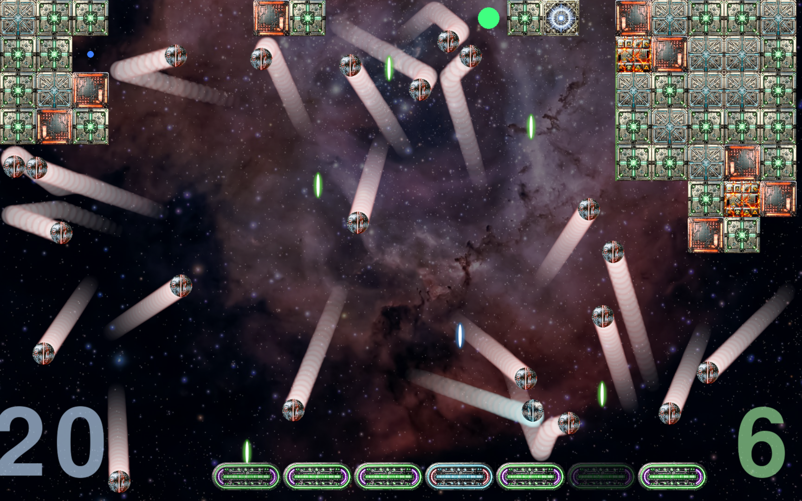
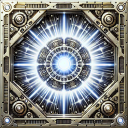
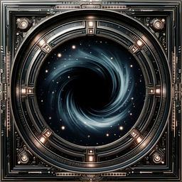

# Breakout

A modern, Pygame-based take on the classic brick-breaker. Clear all destroyable bricks while keeping the blue “hero” ball in play. Power-ups, lasers, inversion, and multi-ball keep things lively.



## Features

- Six handcrafted levels with per-level brick layouts
- Multiple brick types with unique effects and hit points
- Bonus balls, extra bats, control inversion, laser mode, and blackout mode
- Stereo-panned sound effects and chiptune background music (toggle with **M**)
- Multi-monitor aware with dynamic resizing
- Smooth intro scene with perspective-warped card and animated balls

## Requirements

- **Python**: 3.10 or newer  
- **OS**: Windows, macOS, or Linux with a working SDL2 video driver

### Python packages

Installed via `pip`:

- `pygame` – rendering, input, audio
- `opencv-python` – intro image warping
- `numpy` – array ops and masks

#### Dependencies

```txt
pygame>=2.5
opencv-python>=4.9
numpy>=1.24
```

Note: this game is also compatible with Pygame Community Edition. If you would prefer to use that, simply replace `pygame` with `pygame-ce` in the installation process.

## Installation and Setup

```bash
# 1) Create a virtual environment (recommended)
python -m venv .venv

# 2) Activate the virtual environment
# Windows
.venv\Scripts\activate
# macOS/Linux
source .venv/bin/activate

# 3) Ensure the 'pip' tool is up to date
python -m pip install -U pip

# 4) Install dependencies
pip install pygame opencv-python numpy
```

## Running the game

```bash
# 1) Activate the virtual environment (if you haven't already done so)
# Windows
.venv\Scripts\activate
# macOS/Linux
source .venv/bin/activate

# 2) Start the game
python breakout.py
```
You can also pass the `--ratio` (or `-r`) parameter to scale the graphics down by a specified amount, e.g.

```bash
python breakout.py -r 4
```
will down-scale all of the graphics by a factor of four (horizontally and vertically). Higher values give more retro vibes! If your machine struggles to play Breakout smoothly at full resolution, increasing the `-r` parameter should reduce CPU load.

## Mouse sensitivity

Pointer movement is scaled so that moving the bat from one side of the playfield to the other takes the same hand movement on any monitor, whatever its resolution. If you'd like it quicker or slower, pass `--sensitivity` (or `-s`): `-s 1.5` needs a third less movement, `-s 0.75` a third more.

## Web version

There is also a browser version in the `web` folder, a straight port of the game to JavaScript and the HTML canvas. It uses the same sprites, sounds and music, fills the browser tab (press **F** for fullscreen), and supports touch as well as the mouse. It needs to be served over HTTP rather than opened as a file, because browsers won't let a page fetch audio from disk:

```bash
# From the repository root
python -m http.server 8000
```

then open http://localhost:8000/web/ in a browser. Controls are as above, with these differences: click or tap the title card and the intro to start, **Q** returns to the intro, and on a touch screen a finger moves the ball (intro) or drags the bat (play), a tap serves or kicks, and a two-finger tap pauses. The bat follows the mouse pointer normally; if you'd rather have the mouse captured so it can't wander off the page, press **L** during play (a message confirms it, and **Esc** or **L** releases it again). Options go on the URL: `?music=0` starts silent, `?volume=0.25` sets the music volume, `?sensitivity=1.5` scales mouse movement, and `?debug=1` enables the cheats.

## Monitor selection

If you have multiple monitors, you can pass the `--monitor` (or `-m`) parameter to specify the desired monitor number (with 0 being the primary display).

```bash
python breakout.py -m 2
```
If this parameter isn't passed and there are multiple monitors detected, you will see a monitor selection icon in the top-left of the intro screen. Clicking this will move the game to each monitor in turn.

## How to play

- **Goal**: Destroy all destroyable bricks in a level without losing all of your lives.
- **Lives**: You lose one life each time the blue hero ball falls off the bottom. Some bricks grant extra lives.
- **Levels**: Clear a level to advance.

### Controls

- **Mouse**: Move the bat horizontally. Where the ball lands on the bat sets the angle it leaves at: the centre sends it straight up, the ends send it off sideways
- **Left click**: Launch the ball when it is sitting on the bat (it launches by itself after a few seconds). Hold the bat still to send it straight up, or flick the bat sideways as you click to send it off at an angle. Otherwise, a click speeds all the balls up a little
- **Space**: Pause or resume
- **M**: Music on or off (also works on the intro screen)
- **Q / Esc**: Quit

### Music

The intro and each level have their own chiptune track, played at a volume that leaves room for the sound effects. Levels 4 to 6 bring the first three tunes back faster (and higher), old-school style. Start with it off using `--no-music`, or set the level with `--music-volume 0.25` (0 to 1). The tracks live in the `music` folder; see `music/CREDITS.txt`.
- **Intro screen**: Move the mouse over the menu to select a difficulty, then click or press any key

### Brick types

| Brick | Type | Description |
|-------|-------|-------------|
|  | **Blue** | Standard; no effect |
|  | **Red** | Spawns a temporary red bonus ball |
|  | **Green** | Adds a temporary extra bat |
|  | **White star** | Grants an extra life |
|  | **Black hole** | Temporarily darkens the screen |
|  | **Yellow arrows** | Temporarily reverse controls |
|  | **Cracked fire** | Destroys neighbouring bricks (cascade) |
|  | **Metal** | Indestructible |
|  | **Warning triangle** | Enables laser mode for a duration |

Different brick types require different numbers of hits to destroy. If no brick is destroyed for a while, an extra bonus ball is introduced.

## Troubleshooting

- **No video device / SDL errors (Linux)**: Ensure you are in a graphical session and SDL2 can open a display. On headless systems set up Xvfb or Wayland appropriately.
- **OpenCV import errors**: Use `opencv-python` wheels rather than `opencv`. On some Linux distros you may need system OpenGL packages.
- **Fonts missing**: The code uses the default Pygame font; if you change it (e.g. to a system font), ensure it is installed.
- **Black bars**: on a monitor wider than 16:9 (or narrower than 4:3) the playfield is letterboxed so the brick layout stays playable. This is deliberate.
- **Windows display scaling**: the game declares itself DPI-aware so that a high-resolution monitor with Windows scaling (for example a 4K panel at 200%) is used at its native resolution rather than the scaled-down size. If you need the old behaviour, set the environment variable `SDL_WINDOWS_DPI_AWARENESS=unaware` before running.

## Debugging

Run with `--debug` to enable a few developer cheats during play: **D** destroys every brick (skipping the level), **right-click** shows the mouse pointer, and **left-click** destroys the brick under it. They are switched off in normal play.

## Credits

- Pygame community (https://www.pygame.org/contribute.html) for an excellent Python module
- The very useful sfxr (https://sfxr.me/) for sound effect generation
- Background music: "Chiptune Adventures" by Juhani Junkala (https://juhanijunkala.com/), released under CC0 via OpenGameArt (https://opengameart.org/content/4-chiptunes-adventure)
- A nod to Arkanoid, Fireball 2 (Archimedes), and other classics
- Final level background: Rosette Nebula (Dylan O'Donnell, https://deography.com/will-you-accept-this-rose-ngc2237/)
- Thanks to ChatGPT for art assistance

---

_Dedicated to Helena and Karen._
